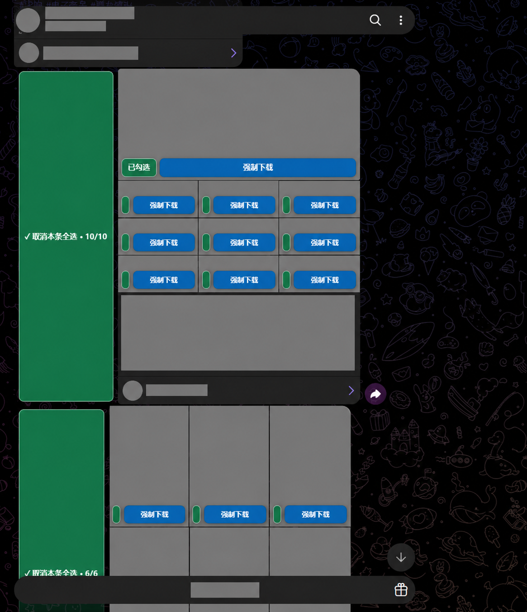
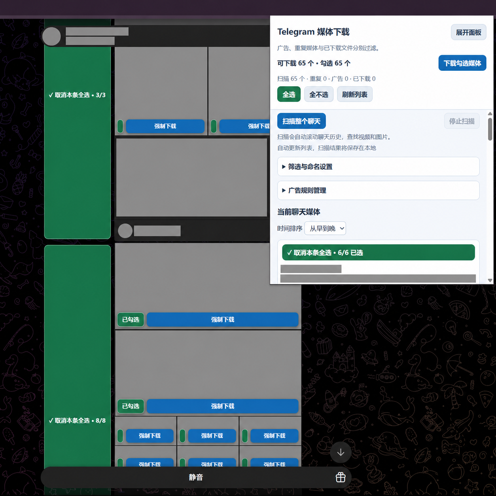
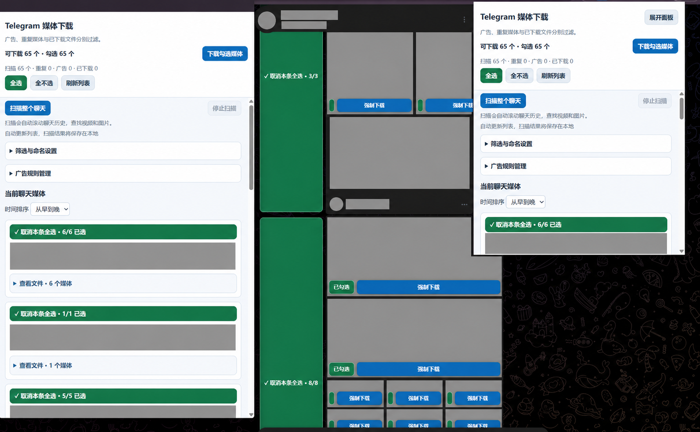

# Telegram Personal Downloader 0.5.2


个人使用的 Chrome Manifest V3 扩展，在 Telegram Web 的当前聊天中扫描和下载视频、图片。包含强制取源、全聊天历史扫描、筛选、分组勾选和自定义命名。没有登录、付费或第三方上传功能。


## 界面示例

以下图片基于 v0.5.2 的实际使用截图，部分文字与细节可能有轻微变化，仅用于说明操作界面。

### 媒体勾选与整条全选

绿色表示已选中，可逐个选择媒体，或使用“本条全选／取消本条全选”操作整组媒体。蓝色按钮用于下载。



### 弹出控制面板

查看扫描与筛选数量、下载已勾选媒体，或展开筛选与命名设置、广告规则管理。



### 独立窗口与折叠列表

点击“展开面板”打开较高、可调整大小的独立窗口。消息文件列表默认折叠，可展开查看和调整单个媒体的勾选状态。



## 下载


从 [Releases](https://github.com/catr54/telegram-personal-downloader/releases) 下载 `telegram-personal-downloader-v0.5.2.zip`。尚未上架 Chrome 应用商店，无需构建或安装依赖。


## 安装与更新


1. 解压发布包，保留整个 `telegram-personal-downloader` 文件夹。

2. 在 `chrome://extensions` 开启开发者模式，加载该文件夹；已有本扩展则更新文件后点击重新加载。

3. 安装时允许所列扩展权限；`downloads` 用于创建下载子目录、应用命名格式和确认浏览器保存结果。

4. 刷新已打开的 Telegram Web 页面，替换旧脚本与旧扫描结果。


## 面板与选择状态


- 工具栏弹窗按屏幕可用空间调整大小，常用操作固定在顶部；媒体列表使用主体滚动区，下载记录默认折叠。

- 点击“展开面板”可打开独立的较高窗口，并继续控制原 Telegram 标签页。可拖动窗口边缘调整大小，适合大屏；较小屏幕自动缩小。

- 页面与面板的选择状态同步：绿色表示已勾选或本条全选，琥珀色表示本条部分选中，白色表示未选。文字和已选数量同时提示状态，避免仅靠颜色判断。


## 扫描、排序和勾选


- 点击“扫描整个聊天”自动翻阅可加载的历史消息，可随时停止。下载时会停止扫描；队列完成前不能开始新扫描，以免同时操作页面。

- 媒体默认按消息时间从早到晚排列，可切换为从晚到早。内部消息接口不可用且页面没有提供完整时间时，未知时间消息排在最后，按消息编号排列，不将扫描时间冒充消息时间。

- 列表按消息分组，每条的文件默认折叠，新发现或从缓存恢复的媒体默认全选；手动取消后不会在当前聊天的自动更新中重新勾选。每条都有全选按钮。它控制该消息所有未被过滤的媒体，包括另一页的媒体；页面媒体旁也提供单个勾选和“本条全选”。

- 单页显示 200 个媒体。下载队列只接收当前筛选后勾选的项目。

- 强制下载会自动点击对应媒体，等待查看器中的真实地址，必要时尝试启动视频播放。图片会等待解码与加载完成，排除头像和导航缩略图。


## 自动更新与本地聊天缓存


- 切换聊天后自动更新列表，恢复该聊天已保存的媒体清单，并合并当前可见消息。关闭浏览器后缓存仍保留，无需重新扫描已缓存的历史。

- 缓存是当前扫描所得的记录，不表示已经扫描了整段历史；第一次需要完整清单时仍需点击“扫描整个聊天”。再次进入聊天会更新可见消息，尚未加载的新历史区间仍需扫描补齐。

- 缓存保存在本机扩展 IndexedDB，按 Telegram Web 路径、账号参数和聊天标识分开保存；不上传。包含媒体标识、消息分组、文件名、用于命名的消息文字和时间、已有图片特征指纹，不包含图片或视频本体，也不保存临时下载地址。

- 从缓存下载时会在原聊天中重新定位媒体、取得有效地址；定位历史可能耗时。缓存中的未加载消息不会被视为已经重新确认存在，删除或无法访问的媒体仍可能下载失败。

- 广告规则、已下载记录与聊天缓存相互独立。缓存读写失败会在面板提示，当前页面列表仍可使用。卸载扩展或清除扩展数据可能丢失缓存。


## 三种独立筛选


在“筛选与命名设置”中分别开启或关闭，然后保存：


1. **合并重复媒体**：按 Telegram 文件标识合并；图片在已有可用缩略图时，额外用本地图片指纹匹配近乎一致的图片。保留排序中先出现的一项。此选项不把重复图片自动认定为广告。

2. **广告过滤**：在某张图片旁点击“标为广告”，记录其文件标识与可用图片指纹。后续匹配的重复广告图片会被过滤，可在“广告规则管理”删除单条规则。规则跨聊天保留，始终存于本机。

3. **跳过已下载**：使用独立的本地完成记录，按文件标识及消息媒体编号匹配。只有 Chrome 报告保存完成才写入记录；失败、中断和仅提交保存的任务不计入。需要重新下载时可关闭此项。


统计分别显示扫描数、重复数、广告数和已下载数。多个条件重叠时按广告、已下载、重复的顺序计数，每项只计算一次。关闭某项筛选会从已收集结果恢复对应媒体，不需要重扫。


**识别边界**：图片指纹使用已加载缩略图的灰度梯度和长宽比，完全在 Telegram 页面本地计算，不上传图像。它可能误判相似图片，也无法保证识别明显裁剪、修改文字或大幅改变构图的广告。低对比度、内嵌模糊预览或跨源限制导致没有可靠指纹时，只使用可取得的文件标识，不强行判断。视频仅按文件标识查重，不分析视频画面。


已下载查重数据库与广告规则分开保存。“清除下载日志”仅清除弹窗日志，不清除这两者。旧版“成功”只表示触发保存，没有可靠完成证据，因此旧版日志不自动导入已下载数据库。本版开始积累可靠完成记录。下载记录表示曾成功保存，不代表文件后来没有被用户删除。


## 直接保存文件夹


所有文件通过 Chrome 下载接口保存，不再生成 ZIP。路径相对于 Chrome 当前下载目录。例如默认设置下：


```text

下载目录/

  Telegram/

    单张图片说明_01.jpg

    一组图片说明_12345/

      一组图片说明_01.jpg

      一组图片说明_02.jpg

      一组图片说明_03.mp4

```


消息原有多个媒体时使用分组文件夹；只下载其中一部分时也沿用该组文件夹，方便之后补下载。单文件消息直接放在根子目录。“下载目录下的子目录”可留空，此时直接使用 Chrome 下载目录。它只支持相对目录，不能填写任意磁盘绝对路径。重名文件由 Chrome 自动添加后缀，不覆盖现有文件。


Chrome 如果仍逐个显示保存位置对话框，可在 Chrome 下载设置中关闭“下载前询问每个文件的保存位置”。扩展不会修改浏览器全局设置。


## 自定义命名


默认根子目录 `Telegram`，分组文件夹 `{text}_{messageId}`，文件名 `{text}_{index}`，时间格式 `YYYY-MM-DD_HH-mm-ss`。


| 标记 | 含义 |

| --- | --- |

| `{text}` | 此消息的正文或说明，没有文字时使用时间 |

| `{timestamp}` | 按自定义时间格式生成的时间 |

| `{date}` / `{time}` | 日期 / 时分秒 |

| `{messageId}` | 消息分组编号 |

| `{index}` | 组内两位序号，从 01 开始 |

| `{type}` | 图片或视频 |

| `{original}` | 原文件名，不含扩展名；无法取得时为 photo 或 video |

| `{ext}` | 根据实际文件 MIME 类型选择的扩展名 |


未写 `{ext}` 时会自动补扩展名。文件夹格式对整组统一计算，避免组内文件进入不同文件夹。时间格式支持 YYYY、MM、DD、HH、mm、ss。命名数据中的特殊字符、路径分隔符及 Windows 保留名称会清理；没有可靠消息时间时，命名回退到首次发现时间。设置区提供使用虚构数据的路径预览。


## 状态与限制


- 下载记录中的“读取文件”是读取 Telegram 媒体数据，“正在保存”表示已交给 Chrome，“保存完成”表示浏览器确认完成。中断原因会显示在下载日志中。

- 浏览器后台重启时，只核对本扩展已登记的下载编号。关闭 Telegram 页面或刷新页面可能使其页面 Blob 地址失效，建议等待队列完成再关闭。

- 全聊天扫描以 Telegram Web 实际可加载的历史为准，不证明服务器全部媒体已被完整枚举。

- 页面结构和 Telegram 内部接口可能变化。若内部接口不可用，将使用可取得的页面信息；图片指纹不可用时可保留媒体继续下载。

- 大文件在页面中按响应范围读取并合成 Blob，仍受浏览器内存限制。本版已移除 ZIP 容量限制。

- 目前属于早期版本，开发期间已有个人使用反馈，但未建立自动化测试及完整兼容性验证。请按自己的使用环境手动确认。


## 参考设计


借鉴 [Powerful Pixiv Downloader](https://github.com/xuejianxianzun/PixivBatchDownloader) 的占位符命名、独立下载记录和浏览器完成状态处理思路，具体参考 `src/ts/FileName.ts`、`src/ts/download/DownloadRecord.ts`、`src/ts/serviceWorker/background.ts`。本扩展为独立实现。


[Chrome downloads API](https://developer.chrome.com/docs/extensions/reference/api/downloads) 支持相对于下载目录的文件路径及子目录，并提供下载完成/中断事件。


## 隐私、许可与反馈


详见 [隐私说明](PRIVACY.md)。广告规则、完成记录和聊天缓存均保存在本地，独立管理。


采用 [MIT License](LICENSE)。本项目为非官方独立实现，与 Telegram 及参考项目无隶属关系。请仅下载自己有权保存的内容。


反馈问题请通过 GitHub Issues 提供 Chrome 版本、Telegram Web 路径（如 `/k/` 或 `/a/`）、扩展版本和脱敏错误信息，避免提交聊天内容、账号信息或未脱敏截图。
